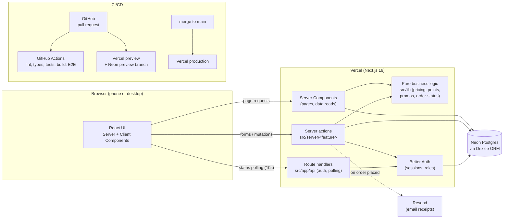
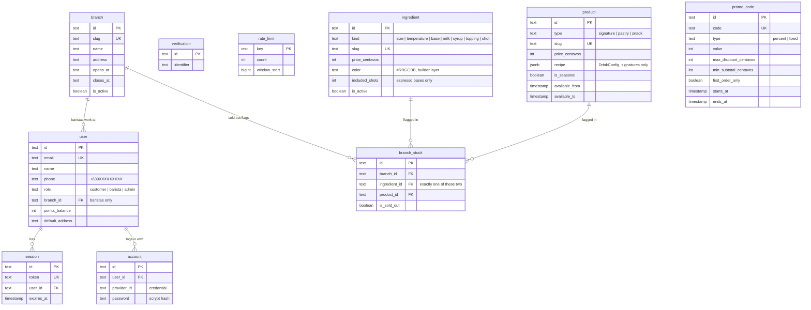

# Architecture

This is a short overview of how Hermes Express is built. The full product spec is in [`PLAN.md`](PLAN.md).

## System diagram



## How a request flows

1. **Reading data:** a page is a **Server Component**. It reads from Postgres through Drizzle on the server and sends finished HTML to the browser. No database code ever reaches the browser.
2. **Changing data:** forms call a **server action** in `src/server/<feature>/`. Every action:
   1. checks the session, role, and (for baristas) branch
   2. validates the input with Zod
   3. uses pure functions from `src/lib` (for example `pricing.ts`) to compute the result
   4. writes to the database
3. **Signing in and roles** (details in [ADR 0002](decisions/0002-auth.md)):
   1. Login and sign-up forms call server actions in `src/server/auth/actions.ts`. Each one validates with Zod, checks the Postgres rate limiter (`src/server/rate-limit.ts`), then calls Better Auth, which sets an HTTP-only session cookie.
   2. `src/proxy.ts` (Next.js 16's name for middleware) runs before protected pages. No session cookie → redirect to `/login?next=…`. It only looks at the cookie.
   3. The page or action then calls `requireUser()` or `requireRole([...])` from `src/server/auth/session.ts`. These load the session from the database and check the role. This is the real security check.
   4. Which paths need which role is defined once in `src/lib/roles.ts`.
   5. The header reads the session inside `<Suspense>`, so the rest of every page can still be prerendered (Cache Components).
4. **Menu and prices** (Stage 3):
   1. `getCatalogSnapshot()` in `src/server/catalog/queries.ts` loads every ingredient, product and sold-out flag in one query batch. It is cached (`"use cache"`, tag `catalog`, up to an hour); admin edits in Stage 7 will refresh it with `updateTag("catalog")`.
   2. Pure functions in `src/lib/catalog.ts` turn the snapshot into the menu for one branch: hide inactive or out-of-season items, group by type, and mark items sold out. A signature drink is also sold out when an ingredient in its recipe is.
   3. The page sends every branch's sold-out list with the menu (`soldOutSlugsByBranch()`). The client component `MenuBrowser` swaps the "Sold out" labels the moment a branch is tapped, with no network request, and saves the choice in the `hx_menu_branch` cookie so the server renders the same branch after a reload. Before JavaScript loads, the buttons submit to the `selectBranch` server action instead (validated with Zod).
   4. Product photos live in `public/images/menu/<slug>.jpg`, are referenced by `product.image_url`, and are served through Next.js `<Image>`. Photographer credits are in `src/config/photo-credits.ts` and shown on `/credits`.
   5. `/menu` and the landing page read the database only at request time, inside `<Suspense>` after `connection()`. The page shell is still prerendered, and a build with no database (CI) works. If the database can't be reached, a polite message replaces the cards.
   6. `calculateDrinkPrice(config, catalog)` in `src/lib/pricing.ts` is the only price calculation. A drink built from scratch costs the sum of its parts. A customized signature costs its menu price plus the difference made by the changes, so an unchanged signature always costs its menu price. `calculateCartTotals()` adds lines, caps the discount and applies the ₱49 delivery fee (free from ₱800).
5. **Coffee builder** (Stage 4, `/build`):
   1. `BuilderContent` (a Server Component inside `<Suspense>`) loads the cached catalog snapshot, the branch cookie and the query string. `toBuilderCatalog()` in `src/lib/builder/catalog.ts` shapes the options for each step, and `soldOutIngredientsByBranch()` sends every branch's sold-out ingredients, so switching branches is instant like on `/menu`.
   2. `resolveBuilderStart()` (`src/lib/builder/start.ts`) picks the starting drink: a signature recipe for `?from=<slug>` (or the older `?drink=`), otherwise an empty cup. `?edit=<cartItemId>` waits for the Stage 5 cart.
   3. The client component `CoffeeBuilder` keeps everything in one `useReducer` built on `reduceBuilder()` (`src/lib/builder/state.ts`): the drink in progress, an undo stack (50 versions), the starting drink for Reset, the step and the quantity. Invalid changes (a hot Cold Brew, a fourth syrup) are ignored by the reducer, not just hidden in the UI.
   4. The live price is `calculateDrinkPrice()`, the same function the server will use at checkout, so the two can never disagree.
   5. `BuilderCup` draws the drink from pure helpers in `src/lib/builder/visual.ts` (layers, mixed colour, toppings, ice) and animates it with Motion: pour, stack, mix. With reduced motion it shows the finished drink.
   6. "Surprise me" uses `randomDrink()` (`src/lib/builder/random.ts`), which only picks options available at the branch.
6. **Live updates:** the order tracker and barista queue poll a route handler every 10 seconds. This is simpler than websockets and works well on serverless hosting (ADR coming in a later stage).

## Folder structure

```
src/
├─ app/          Routes (App Router). Pages, layouts, route handlers.
├─ components/   React components. ui/ = shadcn primitives, <feature>/ = feature components:
│  ├─ brand/     Logo mark, wordmark, Hermes mascot (one-colour SVG, currentColor).
│  ├─ layout/    Site header, desktop nav, mobile tab bar, footer, nav-items list.
│  ├─ landing/   Landing page sections (hero, how it works, featured, teaser, rewards, branches).
│  ├─ menu/      /menu: product cards, branch picker, sections, unavailable message.
│  ├─ builder/   /build: CoffeeBuilder, the animated cup, step panels (steps/), controls, price bar.
│  ├─ theme/     next-themes provider and the light/dark toggle.
│  ├─ sound/     Sound mute toggle (uses hooks/use-sound.ts).
│  ├─ auth/      Login and sign-up forms, labelled form field.
│  ├─ profile/   Profile edit form.
│  └─ staff/     Role-guarded placeholder for /barista and /admin.
├─ config/       site.ts: name, tagline, contacts, branches (single source of truth).
├─ db/           Drizzle client (index.ts), schema.ts, migrations/, seed.ts, seed-env.ts,
│                catalog-data.ts (the PLAN §6 menu) and seed-catalog.ts (inserts missing rows only).
├─ lib/          Pure, framework-free business logic. Heavily unit tested (90% gate).
│  ├─ auth.ts    Better Auth setup (created lazily on first use).
│  ├─ roles.ts   Roles and which paths need which role.
│  ├─ money.ts   formatPeso() and centavo helpers.
│  ├─ pricing.ts calculateDrinkPrice() and calculateCartTotals() (100% tested).
│  ├─ catalog.ts Menu building, seasonal availability, sold-out rules.
│  ├─ builder/   Builder state machine (state.ts), start drink, random drink, cup visuals.
│  └─ validation/ Zod schemas (auth.ts: sign-up, login, profile, PH phone; drink.ts: DrinkConfig).
├─ server/       Server actions and queries grouped by feature (90% gate).
│  ├─ auth/      Session helpers (requireUser/requireRole) and auth actions.
│  ├─ catalog/   Cached catalog queries and the selectBranch action.
│  ├─ profile/   updateProfile action.
│  └─ rate-limit.ts Postgres fixed-window rate limiter.
├─ hooks/        Client-side React hooks.
├─ test/         Test helpers (catalog-fixture.ts: the seed menu as a catalog snapshot).
└─ proxy.ts      Cookie check that redirects signed-out visitors from protected pages.
e2e/             Playwright browser tests.
scripts/         Node scripts run by npm (db-migrate.ts, db-seed-catalog.ts).
docs/            Plan, architecture, setup, ADRs, AI logs.
```

## Design tokens

Colours are CSS variables in `src/app/globals.css`, defined once for light (`:root`) and once for dark (`.dark`, set by next-themes). `@theme inline` turns each one into a Tailwind colour, so `bg-surface` or `text-primary` works in both themes. Components never use raw hex values.

Brand tokens use the names from [`PLAN.md` §3](PLAN.md#color-palette--olympus-café): `background`, `surface`, `surface-muted`, `foreground`, `primary`, `primary-foreground`, `accent`, `accent-foreground`, `success`, `danger`, `border`. shadcn/ui primitives expect their own names, so those are aliases:

| shadcn/ui name       | Points to                | Note                                         |
| -------------------- | ------------------------ | -------------------------------------------- |
| `card`, `popover`    | `surface`                |                                              |
| `muted`, `secondary` | `surface-muted`          | shadcn uses `muted` as a background colour   |
| `muted-foreground`   | PLAN's `muted` text tone | so secondary text is `text-muted-foreground` |
| `input`              | `border`                 |                                              |
| `destructive`        | `danger`                 |                                              |
| `ring`               | `accent`                 | Aegean blue focus outline                    |

Illustration colours (`coffee-espresso`, `coffee-latte`, `coffee-milk`, `coffee-foam`) are tokens too. Fonts: `font-sans` is Inter (body) and `font-heading` is Nunito (h1–h4), both loaded with `next/font`.

Animations are CSS keyframes (`hx-*` in `globals.css`). Each illustration's resting state is the finished drink, and `prefers-reduced-motion: reduce` turns all animations off.

## Key rules

| Rule                                                            | Why                                                                       |
| --------------------------------------------------------------- | ------------------------------------------------------------------------- |
| **Money is integer centavos** (`15000` = ₱150)                  | Avoids floating-point rounding errors. Formatted only in the UI.          |
| **The server recomputes every price** with `src/lib/pricing.ts` | Never trust a total sent by the browser.                                  |
| **Order status changes go through `src/lib/order-status.ts`**   | One place defines the allowed transitions, and invalid ones are rejected. |
| **Authorization on the server** for every action                | Hiding a button is not security.                                          |
| **Order items snapshot their config and prices**                | Later menu edits don't change past orders.                                |
| **Server Components by default**                                | Less JavaScript in the browser; `"use client"` only for interaction.      |
| **Brand text and branches come from `src/config/site.ts`**      | Change them once, and every page updates.                                 |

## Data model

Tables are added stage by stage (users and auth in Stage 2, catalog in Stage 3, orders in Stage 5, rewards in Stage 8). The planned model is in [`PLAN.md` §9](PLAN.md#data-model-drizzle--postgres). Tables so far:



## Environments

| Environment | Trigger            | Database                                   |
| ----------- | ------------------ | ------------------------------------------ |
| Local       | `npm run dev`      | Neon dev branch (via `.env.local`)         |
| Preview     | Every pull request | Neon preview branch, created automatically |
| Production  | Merge to `main`    | Neon main branch                           |

## Notes for AI agents

`AGENTS.md` is generated by Next.js. It tells coding agents to read the version-matched docs in `node_modules/next/dist/docs/`, because Next.js 16 APIs differ from older versions. Project rules are in `CLAUDE.md`.

## Decisions

Architecture decisions are recorded in [`decisions/`](decisions/):

- [0001: Tech stack](decisions/0001-tech-stack.md)
- [0002: Authentication and authorization](decisions/0002-auth.md)
